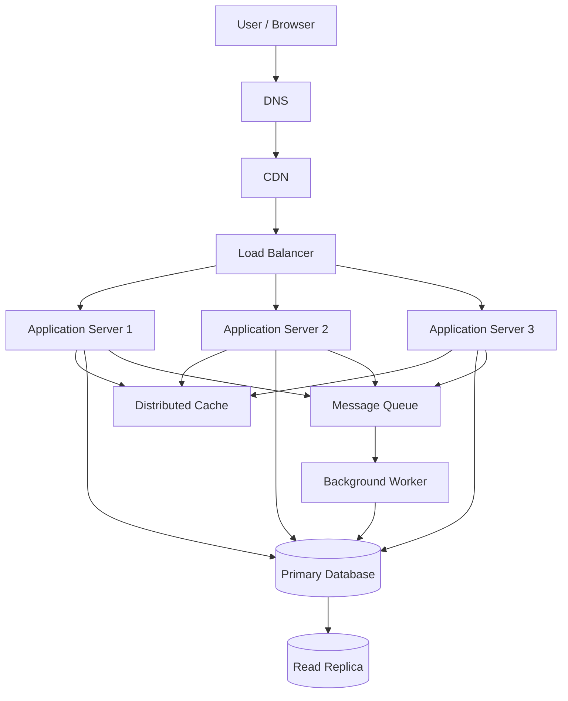

# QuickNotes System Architecture

## 1. Overview

QuickNotes is a note-taking application that allows users to create, view, update, and delete notes. This document describes a scalable architecture designed to support up to one million registered users.

The design separates the client, application services, caching, background processing, and persistent storage. Each component has a defined responsibility, making the system easier to maintain, monitor, and scale.

## 2. Functional Requirements

The system must allow users to:

1. Register and authenticate securely.
2. Create notes with a title and body.
3. Retrieve a list of their notes.
4. View an individual note.
5. Update existing notes.
6. Delete notes.
7. Organize notes using tags.

The system must ensure that users can only access notes they are authorized to view or change.

## 3. Non-Functional Requirements

- **Availability:** Keep the application accessible during individual server failures.
- **Scalability:** Support increased traffic by adding application servers.
- **Performance:** Return common note-list requests quickly.
- **Security:** Use HTTPS, secure authentication, and authorization checks.
- **Durability:** Store notes in persistent database storage with backups.
- **Consistency:** Ensure note changes are correctly reflected in the primary database.
- **Maintainability:** Keep components modular, observable, and straightforward to update.

## 4. Architecture Diagram



## 5. Architecture Components

### 5.1 Client / Browser

The browser displays the user interface and sends HTTP requests to the backend API. It performs basic input validation but does not make security decisions or connect directly to the database.

### 5.2 DNS

The Domain Name System translates the application's domain name into the address of the appropriate entry point. A reliable DNS provider helps users reach the service.

### 5.3 Content Delivery Network (CDN)

A CDN caches static assets such as JavaScript, CSS, logos, and images at geographically distributed locations. This reduces latency and lowers the load on the origin infrastructure.

Private notes and authenticated API responses must not be publicly cached in a way that could expose user data.

### 5.4 Load Balancer

The load balancer distributes incoming requests across healthy application servers. Health checks help it stop routing requests to an unhealthy instance.

Running multiple application servers prevents one server from becoming the only point of application availability.

### 5.5 Application Servers

Application servers implement the API, validate input, authenticate users, authorize access, and coordinate database operations. At least three instances are shown so that traffic can be distributed and capacity can be increased horizontally.

Application servers should remain stateless where practical, allowing requests to reach any healthy instance.

### 5.6 Distributed Cache

A distributed cache, such as Redis, stores frequently requested data temporarily. It can reduce repeated database reads for note-list requests and other suitable queries.

The cache must use user-aware keys and appropriate authorization rules. Cache invalidation is required when notes are created, updated, or deleted. The database remains the source of truth.

### 5.7 Primary Database

The primary PostgreSQL database stores users, notes, tags, and note-tag relationships. It handles writes and provides transactional guarantees for changes to persistent data.

The database should use automated backups, monitoring, access controls, and appropriate storage capacity.

### 5.8 Read Replica

A read replica receives replicated database changes and can serve suitable read queries, reducing the read workload on the primary database.

Replication may be asynchronous, so the replica can briefly lag behind the primary. Requests that require the latest write should read from the primary database.

### 5.9 Message Queue

The message queue holds work that does not need to finish during the user's immediate request, such as sending notifications or processing audit events.

The queue should support retries and durable message storage. Consumers must handle duplicate deliveries safely.

### 5.10 Background Worker

Background workers process queued tasks without blocking normal API requests. More worker instances can be added when the queue grows.

Workers need retry limits and a dead-letter strategy for messages that repeatedly fail.

## 6. Request Flow: GET /notes

When a user requests their notes, the following sequence takes place:

1. The browser sends `GET /notes` to the application's API.
2. DNS resolves the domain, and the request passes through the CDN and load balancer.
3. The load balancer selects a healthy application server.
4. The application server validates the user's authentication token.
5. The server checks authorization and constructs a cache key scoped to the authenticated user.
6. If an appropriate cached result exists, the server returns it after confirming it is safe to use.
7. If the cache misses, the server queries PostgreSQL. A read replica may be used when slightly stale results are acceptable.
8. The server returns the notes in JSON format and may cache the result for a short period.
9. The browser displays the notes to the user.

If the read replica is behind the primary database, the application should use the primary for read-after-write requests.

## 7. Request Flow: POST /notes

When a user creates a note, the following sequence takes place:

1. The browser sends `POST /notes` with the note title and body.
2. The load balancer routes the request to a healthy application server.
3. The server authenticates the user and validates the request body.
4. The server obtains the user's identity from the authenticated session or token rather than trusting a user ID supplied in the request body.
5. The application writes the new note to the primary PostgreSQL database.
6. The database commits the transaction and returns the generated note ID and timestamps.
7. The application invalidates or updates relevant cached note lists.
8. The API returns `201 Created` with the new note.
9. Any optional background work, such as notifications, can be published to the message queue.

The API should acknowledge successful creation only after the database transaction has committed.

## 8. Capacity Planning for One Million Users

The following estimates are illustrative planning assumptions, not measured production traffic.

### Assumptions

- Registered users: 1,000,000
- Daily active users: 10% of registered users
- Requests per daily active user: 50 per day
- Writes: 10% of API requests
- Average stored note content and metadata: 2 KB per note
- Notes created per daily active user: 2 per day

### Estimated request load

Daily active users:

```text
1,000,000 × 10% = 100,000 daily active users
```

Daily API requests:

```text
100,000 × 50 = 5,000,000 requests per day
```

Average requests per second:

```text
5,000,000 ÷ 86,400 ≈ 58 requests per second
```

Estimated writes per second:

```text
58 × 10% ≈ 6 writes per second
```

Actual peak traffic may be several times the daily average, so the infrastructure must be load-tested and sized for expected peaks.

### Estimated storage growth

Daily note creation:

```text
100,000 daily active users × 2 notes = 200,000 notes per day
```

Annual note count:

```text
200,000 × 365 = 73,000,000 notes per year
```

Annual raw note storage:

```text
73,000,000 × 2 KB ≈ 146 GB per year
```

This estimate covers only the assumed note content and metadata. Actual database storage will be higher after indexes, transaction logs, replication, backups, and storage overhead are included.

The estimate also assumes each daily active user creates two new notes per day. If actual usage is lower, storage growth will be lower.

## 9. Scaling Strategy

### Horizontal application scaling

Add more application server instances behind the load balancer as traffic increases. Stateless instances make this easier because user sessions and shared data are not tied to one server.

### Database scaling

Start with a well-configured PostgreSQL primary. Add read replicas when read traffic becomes a bottleneck, and optimize slow queries and indexes before considering more complex database changes.

### Caching

Cache suitable frequently accessed results with short expiration times. Invalidate affected cache entries after successful writes to reduce the chance of serving outdated notes.

### Background processing

Move non-critical work to the message queue. Scale worker instances based on queue depth and processing time.

### Storage management

Monitor database growth, backup size, and query performance. Define backup retention and recovery procedures before the system reaches high traffic.

## 10. Trade-Offs

### Trade-off 1: Cache speed versus data freshness

Caching reduces database traffic and can improve response times. However, cached results may become outdated after a note changes.

**Decision:** Use short expiration periods and invalidate affected cache entries after writes. Use the primary database for requests that require the latest version of a note.

### Trade-off 2: Read replicas versus consistency

Read replicas distribute read traffic, but asynchronous replication can cause temporary delays.

**Decision:** Use replicas for read-heavy requests where small delays are acceptable. Use the primary database for writes and read-after-write operations.

### Trade-off 3: More infrastructure versus operating cost

Multiple application servers, caches, replicas, and workers improve capacity and resilience, but they also increase infrastructure costs and operational complexity.

**Decision:** Introduce each component when monitoring shows a need. Begin with a simpler deployment that can be expanded without changing the API contract.

## 11. Avoiding Single Points of Failure

A single point of failure is a component whose failure can make the whole application unavailable.

The design reduces these risks by:

- Running multiple application server instances.
- Using health checks and a redundant load-balancing setup.
- Deploying infrastructure across failure zones where available.
- Maintaining automated database backups and testing restoration.
- Using database replication and a documented failover procedure.
- Deploying the cache with appropriate redundancy and ensuring the application can handle cache failure.
- Using a durable message queue and retry handling for background work.
- Monitoring service health, error rates, latency, database connections, and queue depth.

A read replica alone does not guarantee automatic database failover. Production deployment must configure and test the promotion of a replica, connection redirection, and recovery procedures.

## 12. Conclusion

QuickNotes can begin with a straightforward API and PostgreSQL database, then scale as usage grows. Multiple application servers, selective caching, read replicas, and background processing can improve performance and resilience.

Capacity estimates should be validated with realistic load tests, and the architecture should evolve based on measured bottlenecks rather than adding complexity without evidence.
